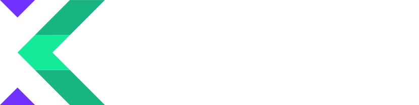
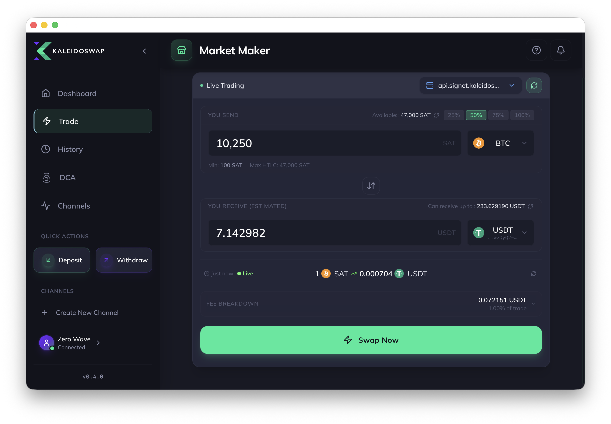

# Kaleidoswap Desktop App

<div align="center">

</div>

## Overview

**Kaleidoswap** is an open-source desktop application for decentralized, trustless trading of digital assets over the Bitcoin Lightning Network using the **RGB protocol**. By integrating seamlessly with an [RGB Lightning Node](https://github.com/RGB-Tools/rgb-lightning-node), the app enables multi-asset trading without intermediaries—giving you sovereignty over your funds.

KaleidoSwap also ships with **Kaleido Mind**, an optional built-in AI assistant that lets you interact with your wallet in plain language—asking questions and carrying out actions such as buying assets, requesting channels, and swapping. You can run the app as **Node**, **Mind**, or both, switchable from **Settings → Capabilities**.

- **Alpha Software Caution**: This software is still in alpha. Swaps may fail or get stuck, and **mainnet usage is not recommended**.
- **Current release**: [Desktop 0.6.0](https://github.com/kaleidoswap/desktop-app/releases/tag/v0.6.0) is the stable distribution release. Trading remains experimental; **Kaleido Mind remains beta**. See the [changelog](CHANGELOG.md) and [release security review](docs/security-review-0.6.0.md).
- **Mind platforms**: Optional runtime downloads are available for macOS Apple Silicon, macOS Intel, Linux x64 and Windows x64. Node mode works without the AI runtime.
- **Documentation**: Visit [docs.kaleidoswap.com](https://docs.kaleidoswap.com) for comprehensive guides and additional details.

## Table of Contents

- [Kaleidoswap Desktop App](#kaleidoswap-desktop-app)
  - [Overview](#overview)
  - [Table of Contents](#table-of-contents)
  - [Screenshots](#screenshots)
  - [Features 🚀](#features-)
  - [Supported Networks](#supported-networks)
  - [Installation 🛠️](#installation-️)
    - [1. Download Binaries](#1-download-binaries)
      - [Verifying Downloads](#verifying-downloads)
    - [Updating to 0.6.0](#updating-to-060)
    - [2. Building Locally](#2-building-locally)
      - [Common Prerequisites](#common-prerequisites)
      - [Windows-Specific Instructions](#windows-specific-instructions)
      - [Linux-Specific Instructions](#linux-specific-instructions)
      - [Building and Running](#building-and-running)
  - [Usage 💡](#usage-)
    - [Connecting to an RGB Lightning Node](#connecting-to-an-rgb-lightning-node)
    - [Trading and Swapping Assets](#trading-and-swapping-assets)
    - [Managing Channels](#managing-channels)
    - [Deposits and Withdrawals](#deposits-and-withdrawals)
    - [Backup](#backup)
  - [Security Considerations 🔒](#security-considerations-)
  - [Roadmap 🛣️](#roadmap-️)
    - [Coming Soon](#coming-soon)
  - [Contributing 🤝](#contributing-)
    - [How to Contribute](#how-to-contribute)
  - [Support 📞](#support-)
  - [License 📜](#license-)
  - [No Responsibility Disclaimer ⚠️](#no-responsibility-disclaimer-️)

## Screenshots



## Features 🚀

- **Asset Trading and Swapping**: Connect to market makers over the Lightning Network to trade BTC and RGB assets with support for reverse quotes.
- **DCA Automation**: Create recurring or price-target DCA orders that buy BTC using your USDT Lightning balance.
- **Limit Orders**: Set limit orders with persistent scheduling and automatic execution.
- **Channel Management**: Open, close, and manage Lightning channels with optional RGB assets.
- **Deposits & Withdrawals**: Handle on-chain and LN transactions for both Bitcoin and RGB assets.
- **Channel Requests**: Request channels from Lightning Service Providers (LSPs) with configurable capacity and included assets.
- **Transaction History**: View deposits, withdrawals, and swap history.
- **Local, Docker, and Remote Node Support**: Run a local RGB Lightning node natively, via Docker, or connect to a remote node.
- **Node Health Monitoring**: Continuous reachability checks with automatic reconnection and clear status indicators.
- **Tray and Background Operation**: Keep the app running in the background while the local node stays active.
- **Multi-language UI**: Use the app in multiple supported languages through the built-in i18n system.
- **Node Backup**: Secure node data backups directly from the settings.
- **Kaleido Mind (AI Assistant, beta)**: Chat with your wallet to get help and perform actions—buy assets, request channels, and swap—through a conversational interface. _(Requires an optional local runtime and model download.)_
- **Flexible Capability Modes**: Run KaleidoSwap as Node only, Mind only, or both, switchable from Settings → Capabilities.

## Supported Networks

- **Mainnet** (experimental)
- **Regtest**
- **Signet**
- **Testnet3**

> **Note**: Mainnet support is experimental. Test networks are recommended for testing and development. Use real funds at your own risk.

## Installation 🛠️

You can install the app in two ways:

### 1. Download Binaries

1. **Download** the appropriate binary for your operating system from the [Releases](https://github.com/kaleidoswap/desktop-app/releases) page.

2. **Verify** the download against the release's GPG-signed `SHA256SUMS` file.

3. **Install and run** the package for your operating system and architecture.

#### Verifying Downloads

Every release includes `SHA256SUMS`, listing the SHA-256 hash of each asset, and `SHA256SUMS.asc`, its detached GPG signature made with the release key:

```
D226 87EA 589C 508E E1FB  2725 9EE3 96C0 4527 55F0
```

Download your installer, `SHA256SUMS` and `SHA256SUMS.asc` from the same release into one folder, then:

```sh
# 1. Import the release key (once) and check that the fingerprint matches the one above
curl -s https://github.com/bitwalt.gpg | gpg --import
gpg --fingerprint D22687EA589C508EE1FB27259EE396C0452755F0

# 2. Verify the signature on the checksum file
gpg --verify SHA256SUMS.asc SHA256SUMS

# 3. Check your download against it
sha256sum --ignore-missing -c SHA256SUMS            # Linux
shasum -a 256 --ignore-missing -c SHA256SUMS        # macOS
```

Step 2 must print `Good signature` from the key above, and step 3 must print `OK` for your file. On Windows, compare the output of `Get-FileHash <downloaded-file> -Algorithm SHA256` in PowerShell with the matching line of `SHA256SUMS`.

Both macOS builds are also code-signed and Apple-notarized, and the app's updater verifies the `.sig` files automatically using its embedded public key.

### Updating to 0.6.0

Use the app's update prompt, or download the matching installer from the release page. The public updater path from **0.5.1 to 0.6.0** was verified on **macOS Apple Silicon**, with the local application database preserved. See the [validation details](docs/security-review-0.6.0.md#validation) for the scope of testing.

**RGB Lightning Node 0.10.0 or later is required.** The bundled node is 0.10.0. Wallets and backups created with the node bundled in desktop 0.5.0 or earlier require a separate migration: node 0.9.0 changed recovery-phrase storage without an automatic migration. Updating the desktop does not migrate those older node wallets. Keep your node backup and recovery phrase before upgrading.

### 2. Building Locally

#### Common Prerequisites

- **Tauri 2 prerequisites**  
  Install the [official Tauri prerequisites](https://tauri.app/start/prerequisites/) for your platform, including Rust, Node.js **22.22.1 or later**, and pnpm.
- **Repository**
  ```sh
  git clone https://github.com/kaleidoswap/desktop-app
  cd desktop-app
  ```

#### Windows-Specific Instructions

1. **Disable RLN Integration (Temporarily)**  
   The `rgb-lightning-node` integration is not yet fully supported on Windows. To get started with RLN on Windows, consider using it in a Docker container and connect remotely.
2. **Install vcpkg**  
   Use [vcpkg](https://github.com/microsoft/vcpkg) to install libraries like **openssl** and **sqlite3**.
3. **MSVC for C++ Linking**  
   Ensure **Microsoft Visual C++** is installed (usually via Visual Studio or Build Tools).
4. **Kaleido Mind on Windows**  
   The optional **Kaleido Mind beta** runtime is available for Windows x64. Download it through the app when enabling Mind; Node mode does not require it.

#### Linux-Specific Instructions

1. **Build Tools and Libraries**  
   Install `build-essential`, `pkg-config`, and SSL libraries on Debian/Ubuntu (or equivalents on other distros).
2. **GTK and WebKit Requirements**  
   Install the Tauri 2 GTK 3 and WebKitGTK 4.1 development libraries. The Ubuntu 22.04 release workflow also installs WebKitGTK 4.0, GLib, AppIndicator, librsvg and patchelf; see [.github/workflows/build.yml](.github/workflows/build.yml) for the exact build dependencies.
3. **Tauri Prerequisites**  
   Confirm correct installation of Rust, Node.js, npm, and pnpm.

#### Building and Running

1. **Install dependencies**:
   ```sh
   pnpm install --frozen-lockfile
   ```
2. **Build the Tauri app**:
   ```sh
   # For current platform
   pnpm run tauri:build

   # For Windows specifically
   pnpm run tauri:build:windows

   # Using Make
   make build-app
   ```
3. **Run Kaleidoswap in development mode**:
   ```sh
   pnpm run tauri:dev
   ```

## Usage 💡

### Connecting to an RGB Lightning Node

1. **Launch** Kaleidoswap.
2. **Choose your node mode** during setup:
   - Run a local instance of [rgb-lightning-node](https://github.com/RGB-Tools/rgb-lightning-node) managed by the app (native binary),
   - Run the node via **Docker** (automatic image pull and container management), or
   - Connect to an existing remote node.
3. **Review connection settings** in the app when needed:
   - Node URL
   - Bitcoind RPC
   - Indexer URL
   - RGB proxy endpoint

### Trading and Swapping Assets

1. **Select or Add a Market Maker** on the **Settings** page.
   - KaleidoSwap currently provides two built-in makers: one for **regtest** and another for **signet** (mutinynet). Supported assets and pairs can be found at [KaleidoSwap RGB Registry](https://registry.kaleidoswap.com/).
2. **Check Supported Pairs**: Ensure you have at least one Lightning channel funded with the RGB asset you want to trade.
   - If you lack a channel, you can **buy one** from an LSP that supports your chosen RGB asset.
3. **Initiate the Swap**:
   - Go to the trading interface, pick your maker and select a supported trading pair.
   - Accept the RFQ price to execute the swap.
4. **Optionally configure DCA**:
   - Create scheduled or price-target DCA orders to automate BTC buys using your USDT Lightning balance.
   - Keep the node unlocked and online while DCA orders are active.

> **Important**: Since Kaleidoswap is in alpha, swaps may fail or get stuck. Check the [docs](https://docs.kaleidoswap.com) for troubleshooting, and feel free to [open an issue](#support-) if you encounter problems.

### Managing Channels

- **Open Channels**: Create channels with custom liquidity and optional RGB assets.
- **Close Channels**: Close channels within the app when no longer needed.
- **Request Channels**: Use the **Buy New Channel** page to request a channel from an LSP, specifying capacity and asset details.

### Deposits and Withdrawals

- Perform Bitcoin or RGB asset deposits/withdrawals either on-chain or via Lightning.
- Use BIP21 deposit URIs for convenient on-chain Bitcoin deposits.
- Monitor your transaction history to verify operations.

### Backup

- Use the **Settings** page to back up your node data. Store your backup securely to prevent data loss.
- Keep your recovery phrase and exported backups offline and encrypted where possible.

## Security Considerations 🔒

- **Node Availability**: Keep your node online to ensure consistent Lightning functionality.
- **No API Authentication Yet**: Avoid exposing the node's API to untrusted networks.
- **Alpha Software**: This is alpha software; do not risk real funds or large amounts on mainnet.

## Roadmap 🛣️

### Coming Soon

- **📊 Advanced Trading Dashboard:** Support for limit orders, stop-loss, and more advanced trading features.
- **🔗 P2P Trading via Nostr:** Enable decentralized peer-to-peer trading using the Nostr protocol.
- **🔐 TOR Support:** Integrate TOR for enhanced privacy and anonymity.
- **🤖 Expanded Automation:** Broaden recurring trading and execution controls beyond the current DCA flows.
- **✨ Improved UI/UX Design:** Further refine the user interface for a better overall experience.

## Contributing 🤝

We welcome contributions of all forms—bug reports, feature requests, and pull requests!

### How to Contribute

1. Fork and clone the repository:
   ```sh
   git clone https://github.com/your-username/desktop-app.git
   cd desktop-app
   ```
2. Create a new branch:
   ```sh
   git checkout -b feature/YourFeatureName
   ```
3. Commit and push your changes, then open a pull request.

## Support 📞

- If you run into any issues or want to request a feature, please [open an issue](https://github.com/kaleidoswap/desktop-app/issues).
- Additional documentation is available at [docs.kaleidoswap.com](https://docs.kaleidoswap.com).

## License 📜

Kaleidoswap is licensed under the [MIT License](LICENSE).

## No Responsibility Disclaimer ⚠️

**USE AT YOUR OWN RISK**: Kaleidoswap is provided "as is" without any warranties of any kind, either express or implied.

- The developers and contributors of Kaleidoswap assume **NO RESPONSIBILITY** for any losses, damages, or other liabilities that may arise from using this software.
- By using Kaleidoswap, you acknowledge that you are using experimental software and accept all associated risks.
- You are solely responsible for the security of your funds, private keys, and any transactions conducted through the application.
- We strongly recommend testing with minimal amounts on test networks before considering any use on mainnet.
- The software may contain bugs, errors, or security vulnerabilities that could result in the loss of funds.

---

_Thanks for using Kaleidoswap! We're excited to see what you build, and we appreciate your feedback and contributions._

### AI runtime baseline

Desktop 0.6.0 downloads `mind-assets-v0.11.1` on demand. Mind core/provider and runtime assets are released as 0.11.1; the desktop Mind experience remains **beta**. Runtime assets were preserved unchanged during the desktop security rebuild.

The bundle uses QVAC 0.21.0 and is LLM-only; it does not add desktop voice support. Dataset collection is not enabled by this dependency update. When the runtime tag changes, existing installations offer the matching download instead of silently reusing an older runtime.

Thinking is optional and can be slower on busy or lower-powered devices. Reduce its budget or disable it for faster replies. Review amounts and tool confirmations before authorizing wallet actions.
